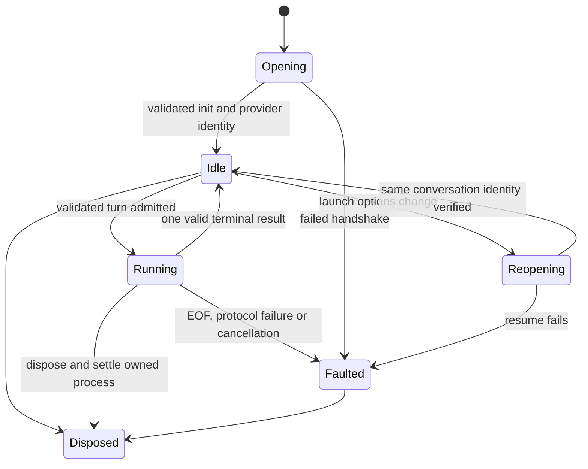

# AGY native agent sessions: technical design

**Ticket:** [DSA-74](https://darkspyre.atlassian.net/browse/DSA-74)

**Combined design:** [DSA-75](https://darkspyre.atlassian.net/browse/DSA-75), with
[DSA-58](https://darkspyre.atlassian.net/browse/DSA-58) for Tensor registry details and
[DSA-76](https://darkspyre.atlassian.net/browse/DSA-76) for Darkspyre adoption.
The epic owns shared contract decisions, sequencing and combined acceptance; this document maps the AGY component.

**Date:** 2026-09-28

**Baseline:** Inference 11.12.0-rc.1, AGY CLI 1.2.12 on macOS.

**Phase:** implemented, unreleased. The runtime-policy and event contract changes were agreed on
2026-09-28 and are implemented on the DSA-75 branch. The [Connect README](../README.md#antigravity-native-agent-sessions)
states current behavior. Section 7's usage evidence gate and section 9's qualification items record
what remains open.

## 1. Outcome and evidence

Expose the AGY runtime through Connect's existing agent service: native conversation creation,
sequential turns, resume, model/effort/schema selection, text, native tool observations, usage and
bounded process teardown. Keep the current chat adapter and its provider-owned setup/discovery.
Google credentials and durable conversations remain owned by AGY.

Live observations from this chat, using temporary workspaces and small prompts:

| Check | Evidence |
| --- | --- |
| Existing wrapper | Authentication, model discovery and text succeeded; 19 regression tests passed |
| Schema | Canonical final result validated; displayed deltas also contained intermediate wrapper/tool metadata |
| Native tools | `view_file` read a known fixture |
| Conversation | Two turns retained the fixture; a new process resumed it by exact conversation ID |
| Control input | `control_request` failed with exit 2 and zero turns |
| Image input | Image content block failed with exit 1 and zero turns |
| Initialization | An `init` containing a conversation ID arrived with stdin open, before any prompt |
| Empty conversation resume | Closing that process and reopening its ID preserved identity, with a schema present in the new init |
| Native tool inventory | Startup included `invoke_subagent`, `schedule`, command, write and browser tools |

The last two checks made no model requests. These observations establish protocol behavior on this
machine, not broad platform qualification or a promise about every model. `--effort max` appears in
installed CLI help but has not been qualified. Existing Low/Medium/High support remains the initial
mapping; Maximum is a qualification item, not an inferred alias for High.

## 2. Components and ownership

| Component | Change |
| --- | --- |
| `AntigravityCliLlmClient` | Reuse shared protocol projection; retain ordinary chat, discovery, usage and authentication |
| New internal `AntigravityAgentClient : ILlmAgentResumeClient` | Start/resume native sessions on `GoogleAntigravityCli` |
| New internal `AntigravityAgentSession` | Own identity, process generation, turn state, event routing and usage ledger |
| AGY process implementation | Support an open stdin pipe, one stdout reader, serialized writes, bounded stderr and reliable disposal |
| Shared internal AGY protocol parser | Parse typed allowlisted init/step/result data once for both chat and agent paths |
| `AddLlmConnect` | Register the agent client; retain one chat client and one agent client per transport |
| Existing ConsoleTester | Capability-driven `agent` command and explicit `agy-probe` cases |

Keep these inside `Darkspyre.Inference.Connect.LLM`; no new package or public CLI protocol wrapper.
Reuse process-start validation/UTF-8 handling and common schema validation. Refactor AGY's one-shot
runner to consume its session-process implementation; do not maintain two process owners. Reuse the
pattern of Claude's process seam, not its control protocol or a fabricated Claude connection.

Current `NativeAgentContract.ValidateConnection` assumes host tool support; parameterize its
implemented capabilities so AGY cannot accidentally inherit `SupportsAgentToolUse=true`.

## 3. Required public contract proposal: runtime policy ownership

### Why the current shape cannot represent AGY honestly

`LlmAgentNativeRuntimeOptions` currently offers host-selected writable roots, network access,
sandbox and approval policy. Session/resume options separately default
`AllowRuntimeBackgroundWork=false`. AGY's launch interface does not give us equivalent enforcement.
Its startup tool list still includes background-capable tools. Requesting `--sandbox` alone cannot
certify `ReadOnly`, an exact writable-root set, disabled network or disabled background work.

Do not reinterpret existing values, silently ignore them, or call `--mode plan` a read-only boundary.
The published permission documentation also distinguishes configured AGY policy from Connect host
callbacks [S2, S3].

### Proposed shape

Replace the flat policy members with one explicitly selected policy on the existing runtime options:

- `LlmAgentNativeRuntimeOptions`: `WorkingDirectory`, `Ephemeral`, `Policy`.
- Abstract `LlmAgentRuntimePolicy` with exactly two supported variants:
  - `LlmAgentHostRuntimePolicy`: existing `WritableRoots`, `NetworkAllowed`, `Sandbox`,
    `ApprovalPolicy`, and `AllowRuntimeBackgroundWork`.
  - `LlmAgentProviderRuntimePolicy`: explicit delegation to the provider's configured runtime policy.
- Add `SupportedRuntimePolicies` to `LlmAgentCapabilities`, a set of
  `LlmAgentRuntimePolicyKind` (`HostControlled`, `ProviderConfigured`). Managed runtimes report an
  empty set; Claude/AgentCore initially report HostControlled; AGY reports ProviderConfigured.

Move the background-work switch into the host-policy variant and remove the former session/resume
members. Keep `ResourceOutputRetentionBytes` at session/resume level because it is observation
retention, not execution authority. Default `Policy` remains a new host-policy value with the current
defaults; AGY requires an explicit provider-policy value. A null resume runtime continues to use the
documented host defaults and therefore fails for AGY: the host must supply its stored AGY runtime
selection and working directory. This prevents implicit delegation during resume.

AGY always requests its terminal sandbox and disables slash expansion; its own installed settings
still determine permissions. Connect does not edit global/project settings, inject a permission
bypass, read credentials, or generate a custom agent to evade an unsupported control. `Ephemeral=true`
is rejected because the native conversation is persisted. Working directory is validated and passed
as process cwd; it is not represented as a guaranteed filesystem boundary.

ProviderConfigured includes background behavior under AGY's policy. It does not promise enumeration,
interruption or cleanup of provider-side jobs. `ResourceObservation=Unsupported` makes that limitation
visible. Stop/disposal terminate the owned local process, not all work the provider might retain.

### Migration obligation

This is a coordinated public contract change, not a silent 11.12 patch. Update every producer,
validator, adapter, example, test double, ConsoleTester caller and host persistence mapping in the
same implementation unit. Claude/AgentCore retain their current policy mappings; managed runtimes
continue rejecting native runtime options. Unknown policy variants fail before process/remote work.
No parallel legacy policy members or dual readers.

Darkspyre must explicitly select provider policy for AGY and present its actual control limits. Existing
Claude/AgentCore runtime settings map mechanically into the host-policy variant. Host adoption is tracked by DSA-76 under DSA-75; do not change DSA-68's released 11.12 contract into a moving target.

## 4. Capability mapping

| Contract | AGY declaration |
| --- | --- |
| `SupportsAgentSessions` | true after qualification |
| `SupportsAgentToolUse`, chat `SupportsToolUse` | false: no host tool callback/result protocol |
| `ContextOwnership` | Provider |
| `ContextImport` | None in this scope |
| `SupportsNativeResume` | true |
| `ToolExecutionOwnership` | Provider |
| Context capture/replacement/status and compaction handoff | false |
| `CompactionOwnership` | Provider; no Connect handoff or guarantee of when native compaction occurs |
| `NativeFork`, `Steering` | None |
| `SupportsInterrupt` | false; cancellation closes the local session rather than a resumable in-process interrupt |
| `ResourceObservation` | Unsupported; unavailable is not an empty authoritative resource inventory |
| Prompt images/documents and host rich tool results | unsupported |
| `SupportsAgentTurnInstructions` | false |
| Output-token cap / temperature | unsupported, preserving current behavior |

Reject host tools (including a supplied handler), imported context, host identities, managed execution
options, attachments and instruction overrides before dispatch. Also reject nonempty session/resume
`Instructions`: no verified AGY system-instruction transport exists. Do not silently append these as
user text. Keep existing chat instruction-as-transcript behavior separate and documented.

Unknown strict-tool capability remains attemptable under the 11.12 policy wherever host tools are
supported. AGY's lack of host tool execution is an independent limitation; this design does not turn
Unknown strict evidence into a tool-support gate.

## 5. Session lifecycle and launch controls

Use one session owner and one serialized reader; no parallel dispatch to one conversation.

Start waits for init with a bounded handshake (proposed 15 seconds plus caller cancellation), verifies
the envelope and returns its actual conversation ID as both ThreadId and SessionId. Never fabricate
a resumable ID or submit a hidden prompt to get one. Resume passes `--conversation <exact-id>`;
init must match it. `--continue` is forbidden because it can select somebody else's latest thread.
Provider IDs are parsed as opaque bounded identifiers, never as paths or shell text.

Keep the process across turns when launch configuration is unchanged. Freeze model, effort and output
schema for each admitted turn. A turn override applies to that turn only; the next request resolves
against session defaults again. When the tuple changes, close stdin while idle, await clean exit,
reopen the exact conversation with new flags, validate init, and only then send the prompt. This is
configuration application before a request, not an automatic retry of a sent request. Empty-thread
resume was verified; model/effort/schema changes and schema removal after completed turns still need
focused qualification.

One turn may run at a time; overlapping calls reject before writes. Stream methods remain lazy and
surface validation errors on first enumeration. Generate one local TurnId per admitted host request;
item IDs include process generation and step index so restart cannot reuse an item identity. Validate
conversation IDs and the user-input boundary before attributing any step. Unexpected idle output or
unattributable provider work must not be assigned to the next host turn. Fail the session with a safe
diagnostic if the first implementation cannot route it reliably; do not pretend to support background
resource observation. This case is a required fixture and a qualification gate for the chosen mode.

Cancellation/abandoned enumeration kills and awaits the owned process, drains bounded diagnostic
tasks, and faults that session object. Explicit resume creates a fresh object. No hidden continuation
or retry follows cancellation. External native side effects and checkpoint completeness remain
unknown. `InterruptAsync`, steering and unsupported resource operations fail explicitly.

## 6. Event and structured-output mapping

| Native observation | Neutral mapping |
| --- | --- |
| Validated turn admission | `LlmAgentTurnStartedEvent` |
| `agent_response` text delta | `LlmAgentTextDeltaEvent`, only for ordinary text turns |
| Tool ACTIVE/DONE | `LlmAgentToolEvent`, stable item, native name/arguments, null success until reported |
| Canonical ordinary result | `LlmAgentMessageCompletedEvent`; complete text reconciles streamed partials |
| Canonical schema result | One `LlmAgentStructuredOutputSnapshotEvent`, then message completion with canonical JSON |
| Native step usage | `LlmAgentUsageEvent` under the accounting rules below |
| SUCCESS / ERROR / INVALID | Completed / ProviderFailure / ProviderFailure |
| CANCELED / INTERRUPTED | Interruption |
| WAITING / RUNNING / unknown terminal value | Unknown, with a safe explanation; no invented success |
| EOF without terminal / malformed terminal | Provider failure; never synthesize completion from partial text |

Only declared `agent_response` deltas enter assistant text. Tool traces, user echoes and checkpoint
text do not. In schema mode keep progress separate, buffer answer text, select `structured_output`
from the terminal envelope, validate against the original host schema, and publish the final object
once. Do not stream provisional wrapper JSON or fix schemas/answers by deleting properties.
Missing or invalid canonical schema output fails explicitly for the qualified version; retain no
older free-text fallback unless a separate supported CLI version profile proves that necessity.

Two small event extensions are proposed to avoid abusing warning/text channels:

- `LlmAgentActivityEvent(ThreadId, TurnId, ItemId, Activity)`, carrying adapter-owned progress text.
  Map existing chat activity to the same internal observation; update agent event consumers to render
  it as progress, not transcript content.
- Optional `Output` of type `LlmToolOutput` on `LlmAgentToolEvent`. AGY's reported text output maps to a
  text part with a reported error flag. Null means no reported result. This is a tool observation,
  never a callback or input to a host handler. Existing adapters populate it where their mapping
  already has a result; they do not invent missing output or unsupported rich content.

Map provider-side denial as the native tool's failure when reported. A successful native turn with
a denied tool remains a completed turn; expose the denial so the host does not mistake it for tool
success. Unknown fields never become raw diagnostics. Treat arguments/output as sensitive untrusted
content; preserve semantic values for the host without logging raw envelopes or executable markup.

## 7. Usage accounting

The existing wrapper drops `thinking_tokens` and `cache_read_tokens`. The live session showed growing
cumulative totals on subsequent turns and resume. Public `RunTotals` belongs to one Connect turn,
not the entire persisted AGY conversation.

- Chat and native sessions use `AntigravityStepLedger` for completed `agent_response` and `checkpoint`
  usage keyed by process generation and step index. ACTIVE snapshots, user-input steps, native-tool
  steps and previously accounted steps add no tokens. A repeated DONE replaces that step's usage;
  its text/tool content is not published twice. Conflicting final content is a protocol error.
- Running usage observations replace the estimate for the current turn. A connection or selected-model
  override can disable them. Native sessions use one request ID for the turn's running and final
  observations. The final event replaces the estimate even when final usage is unknown.
- Prefer the complete current-turn step ledger on the first turn after external resume. Do not charge
  the entire resumed cumulative total as new work. Without complete step evidence or a trusted prior
  cumulative baseline, affected values stay null.
- Within an uninterrupted owner, a validated cumulative difference may reconcile turn totals.
  Never add cumulative totals to the step sum. Reset/decreased counters invalidate subtraction and
  require fresh evidence; no clamping to zero.
- `thinking_tokens` becomes a reasoning subset only after verifying whether it is already included
  in `output_tokens`. Cache-read tokens likewise require verified input normalization. Documentation
  examples are not sufficiently consistent to decide inclusion/exclusion across supported models.
  Do not silently inflate input or count reasoning twice.
- Validate nonnegative integral counters with wide intermediates; unrepresentable public counts
  remain unavailable with a safe diagnostic. Absent values are null, not zero. No cache-write count
  is invented. Usage is never repurposed as context occupancy or a cost estimate.

**Open evidence gate:** retain a controlled nonzero cache/reasoning fixture with established field
semantics, and compare step sums, same-process result deltas and resume results. This gate must close
before advertising the new breakdowns as correctly normalized. New turns that fail still report
observed usage honestly, without claiming a complete total.

## 8. Harness, migration and verification

`Program.RunAgentAsync` currently unconditionally registers an echo tool. Change it to offer host
tools only when `SupportsAgentToolUse` is true. AGY selects the explicit provider-policy runtime and
gets no echo handler. Add `agy-probe` to the existing runner; make its case validation derive from
the supplied case set rather than hardcoding Apple/Vertex case names.

Proposed cases: `text`, `structured`, `native-tools`, `session`, `resume`, `controls`, `cancel`.
Use a temporary workspace containing one fixture; no configuration edits, package installation or
permission changes. Start each case with a known CLI version and bounded deadline. `session`/`resume`
use two short turns with an unambiguous marker. `controls` checks launch-option changes, malformed
input rejection and unsupported policies without claiming full harness parity. Explicitly report
pass/fail/skip and metered-call count; no retries. Native tools are not the host-tool `tools` case.

Deterministic tests cover policy migration for every adapter; init-before-input; invalid and changed
identity; empty-thread resume; turn isolation; same/replaced launch tuple; missing/duplicate result;
schema metadata leakage; tool failure/denial; partial and cumulative usage; child failure; cancelled
startup/write/read; abandoned enumerator; bounded output; disposal races; unsupported operation before
effects; provider output arriving while idle. Process doubles must model a persistent stdin pipe,
not return a prebuilt transcript as proof of lifecycle correctness.

Live qualification is explicit and bounded. macOS 1.2.12 evidence does not certify Windows/Linux;
those need process/protocol fixtures and their own published support statement. Run normal restore,
zero-warning builds, tests, format verification and dependency audits after implementation. Release
version/publication remains separately authorized.

## 9. Decisions and remaining gates

1. **Agreed 2026-09-28:** the typed host-controlled/provider-configured runtime policy contract,
   including explicit delegation of background behavior and its host migration.
2. **Agreed 2026-09-28:** the activity event and the optional observed tool-output member.
3. **Protocol qualification:** `agy-probe` on macOS AGY 1.2.12 (2026-09-28) passed effort change,
   schema, schema removal, resume by exact ID, native tool output and cancellation, with 11 turns.
   Explicit model changes and first-turn schema after empty resume have deterministic fixtures only.
4. **Accounting qualification, open:** the live probe confirmed that step usage is per step and result
   usage is cumulative, so per-turn totals use the step ledger or a same-process cumulative difference.
   Cache/reasoning inclusion is still unestablished, so those subsets stay null. Maximum effort remains
   unadvertised until qualified.
5. **Lifecycle:** cancellation kills the local process group, waits at most 5 seconds for the process
   exit, and faults the session. When the process is not reported as exited within that bound, the
   session fault reason names the process ID. No claim is made that cancellation stops persisted
   provider-side jobs. Output while no turn runs faults the session
   instead of reaching the next turn.

Windows and Linux have process and protocol fixtures only; they have no live qualification.

## Sources and local anchors

- [S1: Headless protocol](https://antigravity.google/docs/cli/headless/): public protocol reference;
  session identity, controls and text-only input were also exercised locally.
- [S2: Permissions](https://antigravity.google/docs/permissions/).
- [S3: Terminal sandbox](https://www.antigravity.google/docs/sandbox-mode).
- [S4: Settings](https://antigravity.google/docs/settings?tab=cli).
- [S5: Subagent lifecycle](https://antigravity.google/docs/subagents?tab=cli).
- [Agent contract](../src/LLM/Darkspyre.Inference.Connect.LLM/LlmAgent.cs),
  [capabilities](../src/LLM/Darkspyre.Inference.Connect.LLM/LlmAgentCapabilities.cs),
  [native validation](../src/LLM/Darkspyre.Inference.Connect.LLM/Internal/NativeAgentContract.cs),
  [current AGY adapter](../src/LLM/Darkspyre.Inference.Connect.LLM/Providers/AntigravityCliLlmClient.cs),
  [AGY process runner](../src/LLM/Darkspyre.Inference.Connect.LLM/Providers/AntigravityCliProcessRunner.cs).
