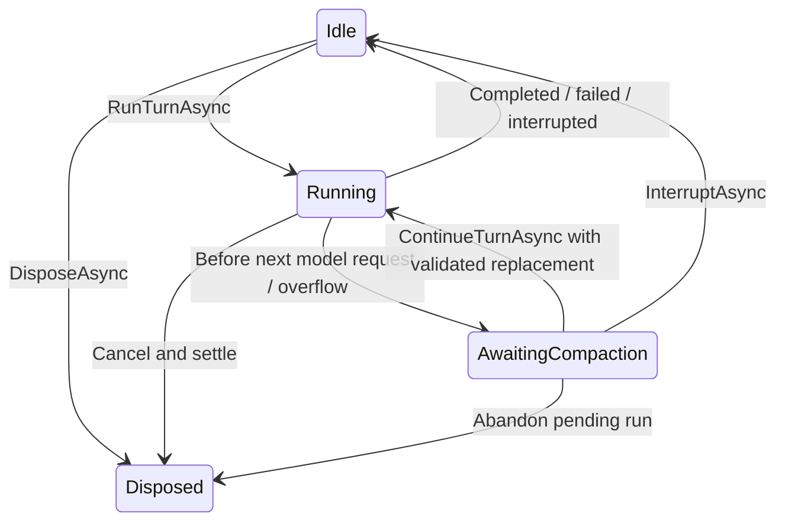

# Technical design: direct Codex and self-owned agent execution

**Status:** Implemented for version 3.0.0. Direct Codex and the managed runtime passed live
tool/attachment, context reopen/fork, and same-run compaction scenarios. See the
[verification record](managed-agent-verification.md). Agent DS integration remains consumer work.
The sections below retain the agreed design and its implementation gates.
See [contract handoff](agent-ds-contract-handoff.md) for the current 10.1.0 consumer migration.

**Date:** 2026-09-21. **Baseline:** Darkspyre.Inference.Connect.LLM 2.2.0, local revision
`fe7bb66`; Agent DS `7cff782`; Pi `c7cdb460aa8a0cebef3446c4166729b8a0d97ead`.

The ownership decisions, direct Codex direction, per-run instructions, context-pressure reporting,
and host compaction handoff are agreed. The signatures and defaults below make those decisions
concrete. Protocol proof is recorded separately; source inspection is not a live test.

## 1. Scope and ownership

Darkspyre.Inference.Connect.LLM restores direct ChatGPT subscription generation and implements its own live agent
engine over that model transport. Agent DS continues to own durable sessions through its existing
`ISessionStore`. Pi supplies evidence about execution behavior; no Pi code, dependency, storage
architecture, or built-in coding tools are ported.

| Concern | Owner |
| --- | --- |
| Model/tool loop, request validation, event ordering, cancellation and safe-boundary steering | Darkspyre.Inference.Connect.LLM live engine |
| Provider wire formats, response-state encoding, attachment encoding, context measurement | Darkspyre.Inference.Connect.LLM adapters |
| OAuth protocol and refresh | Darkspyre.Inference.Connect.LLM direct adapter and existing provider service |
| Protected storage of direct OAuth credentials | Host through existing `ILlmConnectionSource` |
| Claude/Antigravity subscription authentication | Their official CLIs |
| Durable conversation, visible transcript, restore, fork selection, compaction and persistence | Agent DS |
| Tool implementation, approvals, sandbox enforcement, filesystem/network policy | Host tool handlers |
| Native Claude/AgentCore conversation memory | Native runtime, with advertised limitations |

No session database, storage interface, operation journal, durable checkpoint scheduler, automatic
crash replay, plugin framework, or filesystem/shell implementation is added to Darkspyre.Inference.Connect.LLM.
The host persists snapshots as data using its existing store.

The live engine is generic; its first enabled managed-agent transport is direct Codex. This release
does not automatically enable managed agents on every API provider. Claude, Antigravity, Bedrock
Converse and AgentCore retain their existing transport behavior and gain accurate capability
declarations where the shared contract changes.

## 2. Evidence and architectural consequences

### Local source findings at the design baseline (before implementation)

| Source | Finding | Design consequence |
| --- | --- | --- |
| Original `OpenAiCodexLlmClient` at `decc744^` | Direct subscription Responses requests, tools, SSE, OAuth | Restore and update our implementation |
| Baseline `LlmAgent.cs` | Resume/fork use thread IDs; no retained context or context pressure | Extend the existing session seam |
| `LlmChat.cs`, `OpenAiResponsesTools.cs` | One request-level continuation token covers a pending tool response | Preserve adapter state per assistant record across the whole history |
| `LlmModel.cs` | No context/output limit metadata | Add nullable model limits |
| Agent DS `NativeSession.cs`, `ISessionStore.cs` | Separate model and display histories; existing durable fork/replace operations | Integrate complete context with that store |
| Pi `packages/agent/src/agent.ts`, `agent-loop.ts`, `types.ts` | Ordered turns, validated tools, steering queues, cancellation | Use comparable semantics in our engine |
| Pi `packages/ai/src/api/openai-codex-responses.ts` | Direct Codex, encrypted reasoning, affinity keys, SSE and WebSocket | Protocol comparison and live-test checklist |
| Pi `packages/agent/src/harness/execution` and `session/context.ts` | Settled message boundary and separation of context from observations | Keep complete context separate from event/UI projections |

Pi's newer harness also contains unfinished surfaces; its presence does not prove every exposed
operation is production-complete. Its durable repositories, lanes and replay system are outside
this design. We adopt behavior only where it serves Darkspyre.Inference.Connect.LLM's agreed responsibilities.

Official Responses documentation explains retaining encrypted reasoning in stateless conversations.
This supports preserving opaque response state, but does not establish compatibility of the private
ChatGPT subscription endpoint. See [Reasoning models](https://developers.openai.com/api/docs/guides/reasoning).
Context windows include input, output and reasoning allocations; usage for one request differs
from aggregate spending. See [Conversation state](https://developers.openai.com/api/docs/guides/conversation-state).
WebSocket continuation can depend on connection-local cached state; canonical context must survive
a reconnect independently. See [WebSocket mode](https://developers.openai.com/api/docs/guides/websocket-mode).

## 3. Components and dependency flow

```text
Agent DS session + ISessionStore
    | retained context, prompt, tools, run options
    v
LlmAgentProviderService -> ILlmAgentClient -> ILlmAgentSession
    |
    +-- Managed agent engine (first: OpenAiCodex)
    |       +-- existing generation/authentication path -> ILlmClient
    |       +-- adapter context estimator
    |       +-- host tool handler
    |
    +-- Claude CLI agent adapter
    +-- Bedrock AgentCore adapter

Events and context snapshots flow back to Agent DS.
Only Agent DS writes durable session state.
```

Keep one public session contract. The preliminary `ILlmManagedAgentSession` subtype is replaced in
this design by capabilities plus context operations on `ILlmAgentSession`. There is no second agent
facade or alternative message representation for each provider.

Refactor the existing generation/credential preparation path into one internal shared operation if
needed. Both chat calls and managed agent iterations must use it. An agent must resolve/refresh a
short-lived connection before each model call rather than retain the initial OAuth token through a
long tool run. Never have two refresh implementations.

Core owns the engine and neutral records. Adapters own protocol parsers, attachment preparation,
response-state codecs, and measurement. DI continues to enforce one active client per transport.
No implicit fallback between native and managed execution or between API keys and subscriptions.

## 4. Public capabilities and model limits

Add `LlmAgentCapabilities Agent` to `LlmProviderCapabilities`. Its fields are:

| Field | Values / semantics |
| --- | --- |
| `ContextOwnership` | `None`, `Host`, `Provider` |
| `SupportsContextCapture`, `SupportsContextReplacement` | Complete neutral context can be exported/imported |
| `SupportsContextStatus` | Status operation supported; individual measurements may remain unknown |
| `SupportsCompactionHandoff` | Same-run pause/continue around host compaction |
| `SupportsNativeResume` | Persisted provider thread can be reopened by ID |
| `NativeFork` | `None`, `CurrentPosition`, `TurnBoundary` |
| `CompactionOwnership` | `None`, `Host`, `Provider` |
| `SupportsNativeCompaction` | Explicit `CompactAsync` is available; automatic native memory management alone does not imply this |
| `Steering` | `None`, `SafeBoundary`, `Immediate` |
| `SupportsInterrupt` | Explicit active-run interrupt, distinct from enumeration cancellation |
| `ToolExecutionOwnership` | `Host`, `Provider`, `Mixed` where applicable |

Retain existing `SupportsAgentSessions` and `SupportsAgentToolUse`: these answer existence and
host-tool invocation, not state ownership. Add `SupportsAgentTurnInstructions` as already proposed.
Feature overrides can restrict executable behavior, but cannot manufacture an unimplemented method.
Impossible capability combinations fail configuration validation.

Add `long? MaxContextTokens` and `long? MaxOutputTokens` as init properties on `LlmModel`.
These are discovery metadata, not guarantees for every request. Effective session status accounts
for connection/model settings and adapter restrictions. A configured smaller limit takes precedence;
a host override cannot increase a known provider limit. Unknown values are null, not zero.
Manual model limits remain possible when discovery cannot supply them.

`ExecutionOptions.ContextPolicy` supplies manual limits for managed sessions. Discovery metadata
is populated only from verified provider/catalog data; other adapters may leave it null. Persisting
manual choices belongs to the host's existing connection/session configuration.

| Implementation | Context | Host handoff | Native resume/fork | Compaction | Steering |
| --- | --- | --- | --- | --- | --- |
| Managed Codex | Host | Yes | No; open host snapshot instead | Host | Safe boundary |
| Claude CLI | Provider | No | Resume; current-position fork in existing adapter | Unsupported by current explicit method; CLI may manage memory internally | Unsupported by current adapter |
| Bedrock AgentCore | Provider | No | Resume; no fork in existing adapter | Provider-controlled; no explicit compact method | Unsupported |
| Antigravity CLI | No session lane | No | No | N/A | N/A |

The table describes repository behavior and the managed target, not everything upstream products
could support. Native per-turn instructions and context telemetry default unsupported/unknown until
verified independently. Existing prompt/tool attachment and reasoning capabilities remain per kind
and per provider/model.

## 5. Retained context and response state

Use existing `LlmChatMessage`, `LlmToolCall`, `LlmToolResult` and `LlmAttachment` as the neutral
content vocabulary. Context entries add stable identity and provenance:

```csharp
public sealed record LlmAgentContextEntry(
    string Id,
    string TurnId,
    LlmChatMessage Message);

public sealed record LlmAgentContext
{
    public int FormatVersion { get; init; } = 1;
    public long Revision { get; init; }
    public IReadOnlyList<LlmAgentContextEntry> Entries { get; init; } = [];
}
```

Add `LlmProviderResponseState? ResponseState` to both `LlmChatMessage` and `LlmChatResult`.
The state is a versioned, opaque adapter payload with a transport/model binding and an opaque
non-secret connection/account scope identifier. Its bytes contain only allowlisted continuation
content, never credentials, secret headers, diagnostics, or entire unfiltered responses.

Its public serialization fields are `FormatVersion`, `Transport`, `ModelId`, `ScopeId`, and
`Payload` (opaque string). The binding is a compatibility check, not a cryptographic authenticity
claim. Imported state is untrusted; adapters still validate shape and never let it override
credentials, endpoints, instructions, or tool declarations. Ordinary context content can itself be
sensitive, so the host applies its existing storage protections even though credentials are absent.

An assistant entry's response state represents that complete response, including ordered reasoning,
text, calls and other required output items. If present, the adapter uses it instead of separately
serializing the same visible message/calls; it must never duplicate both representations. Multiple
assistant entries retain independent state. Empty visible text may still have essential state.

The existing request/result `ContinuationToken` is replaced by this per-message mechanism.
Update every producer and caller in the same implementation unit, including Responses, Anthropic,
tests, examples and the Agent DS integration. Do not ship both mechanisms. Adapters that do not
need opaque state leave it null. The JSON codec and validation rules remain adapter-owned.

Import validates format version, IDs, message roles, state binding and tool-call/result pairing.
It copies supplied collections and JSON values; the host cannot mutate engine-owned live context.
A fork preserves entry IDs for its copied prefix and assigns a new thread identity. Resuming retains
the host's chosen thread identity. Context revisions are local mutation counters, not database locks.
The host never parses encrypted reasoning; compaction drops summarized records as whole records,
preserving complete unsummarized assistant/tool groups.

No cross-provider/model conversion of opaque state is implicit. By default, model changes that
cannot reuse state fail before mutation. A host carrying retained history to a new conversation opts
in with `LlmUnboundResponseState.Omit`: unbound state is left out of the sent request and the
omission is reported. Raw old state is never discarded without that opt-in. See "Host-supplied
history on a new target".

### Attachment lifetime

Keep binary attachments available for the full live context that still references them, including
later prompts and all tool iterations. Stateless generation may resend them; provider prompt caching
does not make their context cost zero.

Context capture has `LlmAgentContextCaptureOptions.IncludeAttachmentData`, default false, matching
Agent DS's current decision not to persist attachment bytes. With false, retain explicit attachment
descriptors in a new `LlmChatMessage.OmittedAttachments` collection (kind, filename, count/identity)
and remove binary payloads, including attachments nested in tool results. With true, capture exact
bytes; the host chooses how to protect/store them. Neither mode logs payloads.

Omitted descriptors are metadata, not substitute model input. Import publishes a notice that those
attachments are unavailable and excludes them from requests. The host can reattach them or use its
existing file tools; Darkspyre.Inference.Connect.LLM never reads host paths to reconstruct missing bytes. Export must not
strip the live session's bytes. Native CLI attachment lifetime remains adapter-specific.

Capture for live compaction uses `IncludeAttachmentData = true` so replacement context can preserve
the retained attachments. Agent DS can omit bytes from its separately persisted copy under its
existing policy. It must not feed that stripped persistence projection back into the live run
unintentionally. An omitted descriptor identifies its owning message/tool call and attachment index
along with filename and kind; filenames alone need not be unique. Opaque assistant state must not
smuggle omitted user/tool attachment bytes into an otherwise stripped export.

## 6. Session operations and logical run identity

Extend the existing `ILlmAgentSession` with these operations (all take cancellation tokens):

```csharp
Task<LlmAgentCapabilities> GetCapabilitiesAsync(CancellationToken cancellationToken = default);

Task<LlmAgentContextStatus> GetContextStatusAsync(
    LlmAgentTurnRequest? prospectiveTurn = null,
    CancellationToken cancellationToken = default);

Task<LlmAgentContext> CaptureContextAsync(
    LlmAgentContextCaptureOptions? options = null,
    CancellationToken cancellationToken = default);

Task ReplaceContextAsync(
    LlmAgentContext context,
    long expectedRevision,
    CancellationToken cancellationToken = default);

IAsyncEnumerable<LlmAgentEvent> ContinueTurnAsync(
    LlmAgentTurnContinuation continuation,
    CancellationToken cancellationToken = default);
```

Native implementations reject unsupported context/continuation operations before effects.
Keep `RunTurnAsync`, `SteerAsync`, `InterruptAsync`, and native `CompactAsync` on this seam.
Managed `CompactAsync` rejects with guidance to the host handoff; it never silently summarizes.

Add `Context`, optional host-assigned `ThreadId`/`SessionId`, and `ExecutionOptions` to start
options. A managed session starts empty or from that supplied context. Native start rejects supplied
host context/identities it cannot honor. Provider-native `ResumeSessionAsync` and
`ForkSessionAsync` keep their existing purpose; managed adapters reject them and callers use
`StartSessionAsync` with host-selected snapshot/identity. No hidden thread-ID registry is added.

Managed `Ephemeral` does not select a storage backend: all managed sessions are storage-ignorant.
The host's persistence choice is authoritative. Base instructions and executable handlers are
provided on start; they are not recovered from opaque response state. A snapshot intentionally does
not capture transient per-run instructions or delegates.

Add `Instructions` to `LlmAgentTurnRequest`. A logical run has one `TurnId` across model
iterations and compaction pauses. Internal model steps and tool calls have their own stable IDs.
The existing names remain even though Pi calls a single model iteration a turn.

`LlmAgentTurnContinuation` contains `TurnId`, `PauseId`, `ExpectedContextRevision`, and
`ReplacementContext`. Continuation validates the entire replacement and its projected request
before changing live state, then installs it atomically and continues without appending user input.
A successful continuation consumes its pause ID once. A stale or duplicate attempt has no effects.

The serialized continuation request shape is:

```csharp
public sealed record LlmAgentTurnContinuation(
    string TurnId,
    string PauseId,
    long ExpectedContextRevision,
    LlmAgentContext ReplacementContext);
```

Revision increments when admitted context changes, including appending input, settling a model/tool
group, and installing a replacement. The engine assigns the new revision; a caller cannot choose a
revision by setting it on replacement data. Initial import adopts a validated nonnegative revision.

`CaptureContextAsync` is allowed while idle or paused, and after cancellation has settled.
`ReplaceContextAsync` is idle-only, for host-initiated compaction between runs. It uses the expected
revision to reject a stale write. During a pause the host uses the single continuation operation to
avoid a replacement/continue race. Capture/status snapshots do not expose mutable internal lists.

`GetContextStatusAsync(prospectiveTurn)` previews a new run only while idle. It does not append
input, refresh credentials, generate a response, or change the snapshot. While paused, a null request
returns the projection for the pending run. While running, null returns the latest published
snapshot; it is never represented as a fresh prediction for an unbuilt request.

While idle, a null prospective turn measures the retained context with base instructions and the
configured model/tools. Admission validates a new request, appends its user entry once, and emits
`LlmAgentTurnStartedEvent` before its first pressure check. Consequently a pre-request pause already
contains and protects the new prompt. Failure before admission changes neither context nor events.

## 7. Context pressure and limits

### Public nonmutating accounting

Approved for the Agent DS bounded-Core-compaction handoff. The existing provider service and session
seams gain these methods; compaction orchestration and persistence stay in the host:

```csharp
Task<LlmRequestAccounting> LlmProviderService.MeasureRequestAsync(
    string connectionId, LlmChatRequest request,
    LlmAgentContextPolicy? policy = null, CancellationToken cancellationToken = default);

Task<LlmRequestAccounting> ILlmAgentSession.MeasureContextAsync(
    LlmAgentContext proposedContext, CancellationToken cancellationToken = default);
```

Standalone measurement reads the host connection once, uses the selected adapter's generation
projection/validation, and optionally reads model discovery metadata without credential refresh or
credential persistence. It never calls generation, creates a session, writes context or retries with
another model. Catalog/network/provider discovery failure leaves model limits null with a safe
diagnostic; cancellation and invalid input still fail the operation. No raw provider exception is
copied into the accounting diagnostic. Unsupported projection/features or an unimplemented estimator
return `IsSupported = false`. Unknown occupancy on a supported projection keeps `IsSupported = true`
with null count and `Source = Unknown`. There is no tokenizer/character-ratio fallback. Claude CLI
chat and Antigravity CLI chat implement an estimator over their projected transcript with the bundled
`o200k_base` tokenizer, and their diagnostic states that the tokenizer is not the model's and that the
CLI's own framing is not counted.

The session method runs under the existing session lock, only while idle or after a paused segment
has settled. It imports/validates a private proposal copy (including complete tool groups and bound
opaque state), but never installs it, changes IDs/revisions, consumes a pause, emits execution events,
executes tools or persists data. Idle measurement uses base session configuration; paused measurement
uses the actual frozen run model, instructions, reasoning, schema and tools. Queued steering is
included without being consumed. `ContextRevision` is the live revision being compared against, not
the proposal's supplied revision. It is not a reservation or acceptance token: steering can change
without a revision increment. Host coordination and final replace/continue validation remain required.
Native-owned sessions return unsupported; their resolved model may itself be unknown (null).

`LlmRequestAccounting` contains `ModelId`, `IsSupported`, safe `Diagnostic`, nullable `ContextRevision`,
`ModelMaxContextTokens`, `ModelMaxOutputTokens`, effective `MaxContextTokens`, `UsedContextTokens`,
`ReservedOutputTokens`, `SafetyMarginTokens`, `InputBudgetTokens`, `AvailableInputTokens`, nullable
`NeedsCompaction`, `IsEstimated`, `Source`, and `OutputLimitEnforcement`. Token fields are nullable long.
Counts include full projected instructions/tools/schema/messages, not just summarizable history.
The existing managed policy calculation is shared by live status and both accounting operations.
Missing attachment bytes, binary attachments and encrypted state never become free input.
Supported does not mean exact or safe: no fit guarantee is inferred from an estimate, an unknown,
or a false threshold recommendation. Protected-record preservation/reduction checks still belong to
the host and final replacement operation, not a token measurement.

Host context caps cannot enlarge known model context limits. For a standalone enforced output cap,
the reserve is at least that cap (or a larger explicit host reserve); a cap above a known model output
limit is invalid. Without a requested enforced cap, the existing policy/model reserve rules apply.
Absent model limits remain null; a host ceiling is displayed separately from discovered model limits.
The existing OpenAI public model catalog currently contributes no context/output limits. Direct Codex
does expose nullable limits when present in its catalog. No model limits are invented to fill gaps.

Common defines `LlmOutputLimitEnforcement`: `Unknown`, `Unsupported`, `ProviderEnforced`,
`EngineEnforced`. Both existing LLM capability records expose it; Connect's portable adapter maps it.
Responses/Anthropic/Bedrock Converse advertise provider enforcement; Qwen advertises engine enforcement
through its existing max-token runtime argument. Codex/Claude CLI/Antigravity reject caps. Generic
compatible HTTP endpoints and AgentCore harnesses remain unknown, since forwarding a property cannot
prove the remote implementation honors it. Capability overrides cannot manufacture enforcement.
Provider-enforced means the supported protocol enforces the accepted request's cap, not local
containment of a faulty remote endpoint. Truncating visible text/cancelling late is not equivalent.

The host keeps summary and destination accounting separate and owns its shared retry/chunk/deadline
ledger. The standalone path does not enter the managed-agent retry loop. Estimated or unknown input
cannot certify strict bounded fit. Direct Codex cannot provide an enforced summary output cap, even
though its managed context reserve is available; a bounded consumer must report Unsupported with a
diagnostic rather than use another model automatically. Provider-native compaction is separate.

The session-interface addition is included in the breaking-contract release `11.6.0-rc.1`.
The initial implementation was source-only; the user subsequently authorized coordinated publication.
No additional Codex Native browser-restriction changes are included in this accounting unit.

### Existing status and policy contract

```csharp
public sealed record LlmAgentContextStatus
{
    public required string ModelId { get; init; }
    public long ContextRevision { get; init; }
    public long? MaxContextTokens { get; init; }
    public long? UsedContextTokens { get; init; }
    public long? ReservedOutputTokens { get; init; }
    public long? AvailableInputTokens { get; init; }
    public bool? NeedsCompaction { get; init; }
    public bool IsEstimated { get; init; }
    public LlmContextMeasurementSource Source { get; init; }
}
```

`Source` is `Unknown`, `Estimated`, `ProviderReported`, or `Mixed`. Unknown token components
remain null. `NeedsCompaction = null` means insufficient evidence, not safe to continue.
`IsEstimated` is true if any number used in the decision is estimated; `Source` distinguishes
unknown from exact. Cached input tokens remain included in occupied context.

For a pending request, `UsedContextTokens` means projected input occupancy: instructions, tool
schemas, retained messages/state and attachments, new user/steering input, and request overhead.
It excludes the reserved next output. Do not sum all historical billed usage or use the last
response's input count unchanged after editing the context.

`ReservedOutputTokens` covers reasoning and visible output under the adapter's accounting rules.
It is a planning reserve, not a promise that a private backend accepts a max-output wire parameter.
When the backend cannot enforce that limit, mark the estimate accordingly and retain reactive
overflow handling.

Execution options define `ContextPolicy`:

- `CompactionThresholdRatio`: default 0.85, validated greater than zero and at most one.
- `SafetyMarginTokens`: default 4096, nonnegative.
- `ReservedOutputTokens`: optional host reserve; otherwise resolve a verified adapter/model reserve.
- `MaxContextTokens`: optional host cap; never greater than a known hard limit.

The ratio and margin are library planning defaults, not provider facts. If no output reserve can be
resolved, the recommendation remains unknown until the host supplies one; no invented model limit.

When all quantities are known:

```text
inputBudget = max(0, MaxContextTokens - ReservedOutputTokens - SafetyMarginTokens)
AvailableInputTokens = max(0, inputBudget - UsedContextTokens)
NeedsCompaction = UsedContextTokens >= floor(inputBudget * CompactionThresholdRatio)
```

A 200,000-token context, 16,000-token reserve, and 4,000-token margin give a 180,000-token input
budget and a 153,000-token compaction threshold at 0.85. These are illustrative numbers.

Measurement resolution:

1. Adapter-reported limits and exact counts for the exact prepared input, where available.
2. Verified model metadata plus an adapter estimator that understands its request projection.
3. Host cap/reserve overrides, with estimated usage.
4. Unknown components, explicitly marked.

Use an internal context-estimation provider seam alongside `ILlmClient`; share the adapter's input
projection with request construction. It may use a maintained tokenizer, provider-reported
measurements and documented multimodal costs. It must not count encrypted bytes or base64 length as
tokens. Where attachments or opaque state prevent credible measurement, report unknown rather than
a falsely precise total. Estimates and overflow handling both require tests.

A proactive warning is best effort when measurements are unknown. Emit a context-status event so
Agent DS can display that condition; continue unless the provider reports overflow or a known hard
limit is exceeded. Do not request compaction solely because telemetry is unavailable.

## 8. Compaction pause and continuation

Before every model request, including tool follow-ups, the engine builds the projected status.
It emits `LlmAgentContextStatusEvent`. If compaction is required, it sends no model request,
creates a pause ID, emits `LlmAgentCompactionRequiredEvent`, and ends that enumeration.

The event carries the turn/pause IDs, status, reason (`Threshold` or `ProviderOverflow`),
`CanCompactHistory`, and `ProtectedEntryIds`. It is not a turn-completed event. The live session
enters `AwaitingCompaction`; instructions, model, reasoning, schemas, tool loadout, usage,
iteration count, unprocessed steering, and attachment bytes remain associated with that run.



All issued tool calls are settled before a pause. Protect the initiating user input for the current
run and the complete assistant/tool-result group that caused the pending model follow-up.
Also protect steering already admitted since that group. Protected records must be retained intact;
the host can replace earlier complete groups with a neutral user-role summary. This summary is
explicit host-owned conversation content, not a system-instruction substitute.

A replacement must have valid call/result pairs, retain protected records, obey the state bindings,
and demonstrably reduce projected size or remove at least one unprotected complete history group
when exact measurement is unavailable. If a known threshold remains exceeded, reject before
installing it. A failed continuation leaves the same pause available for correction.

If the fixed instructions, tools, current input, attachments or protected tool result alone cannot
fit, set `CanCompactHistory = false`. Agent DS must surface the oversized input/tool result and
interrupt or prepare a new run. Do not enter an endless summarization loop, truncate it silently,
or execute the completed tool again. The host compactor itself must use bounded input (for example,
chunked summaries); forwarding an already overflowing history unchanged to another request is not
a solution.

A structured provider context-overflow error also enters this handoff after a rejected request,
even if the preflight estimate was below threshold or unknown. Only a verified overflow error is
classified this way; auth, quota, generic 400s, or disconnected streams are not compaction signals.

Agent DS's sequence is:

1. Consume the paused enumeration completely and capture context including live attachment data.
2. Summarize eligible earlier records using its own policy and a normal library model call.
3. Persist the replacement through its existing `ISessionStore`.
4. Call `ContinueTurnAsync` with that replacement, revision and pause ID.
5. Persist the resulting context when the next execution segment settles.

Agent DS must prevent concurrent edits to the same session during this sequence. If storage fails,
it does not continue. If continuation validation fails, retain the original durable context or
restore it using the host's existing transaction/rollback policy. A transient request failure after
successful installation leaves the new context authoritative. The two systems have no distributed
transaction and do not claim exactly-once recovery.

Pause/continue is a live-session operation. A snapshot holds settled model context, not a serialized
scheduler. After process death or disposal there is no executable pause token; Agent DS can reopen
the last stored context and explicitly initiate a new run. Automatic recovery of unfinished work is
outside scope. The design does not add journals or recovery methods to `ISessionStore`.

## 9. Run, tool, cancellation and event semantics

`LlmAgentExecutionOptions` contains `MaxModelIterations` (default 32), `ToolExecutionMode`
(default Sequential), `MaxConcurrentTools` (default 4 for Parallel), and `ContextPolicy`.
All numeric options are validated before admitting a run. Pauses/retries do not reset the
iteration counter; transport retries of the same request do not count as another completed model
iteration. Repeated transport failures have their own bounded retry limit.

Add a per-tool `RequiresSequentialExecution` flag to `LlmAgentToolDefinition`. If any call in a
batch requires it, execute that batch sequentially. Parallelism requires explicit host opt-in.
Model permission to emit multiple calls is independent from concurrent host execution.

A complete successful assistant response is appended before invoking tools. Validate registered
names and complete JSON arguments against the declared schema. Unknown tools, invalid arguments,
host-denied calls and handler errors produce error results with the original call IDs. Arguments
from output-truncated or otherwise incomplete responses are never executed. Tool return values
and attachments are validated before the next model call; unsupported attachment output becomes a
failed tool result with an explanatory event, never a silently dropped payload.

Do not add a second generic approval framework: the host handler enforces its permissions and
invokes its approval UI if necessary. Native `ApprovalHandler` remains for native command/file
approvals. Managed sessions do not promise OS sandbox enforcement merely because start options
contain `Sandbox`, `WritableRoots` or `NetworkAllowed`. Capabilities identify execution ownership;
documentation must say those controls govern native runtime tools while host tools need their own
enforcement. `DeferLoading` is rejected by managed Codex until an actual tool-loading mechanism exists.

Once a handler starts it is not automatically replayed. Preserve completed results even when a
sibling tool fails or cancellation wins. Unstarted calls receive explicit not-executed results;
a cancelled started handler with an unknown external outcome gets an interrupted/unknown result.
Wait for handlers to settle before announcing idle; cancellation cannot forcibly stop arbitrary
host code or reverse completed effects.

Tool start/completion observations may reflect parallel completion order. Retained tool results
always follow assistant source order. Complete call/result groups form capture/compaction
boundaries. The public `LlmAgentToolCall` keeps stable turn/call IDs for host correlation.

Streaming adds a neutral `LlmReasoningDeltaEvent` to the chat lane and maps it to the existing agent
reasoning event. Only provider-exposed reasoning text/summary is displayed; encrypted payloads are
never emitted as text. Existing message, tool, warning and completion events remain.

Add:

- `LlmAgentContextStatusEvent`: status snapshot for the current projection.
- `LlmAgentCompactionRequiredEvent`: the pause payload defined above.
- `LlmAgentTurnContinuedEvent`: same turn ID and accepted pause ID; no new start/user event.
- `LlmAgentUsageEvent`: per-request usage and run totals; null for unreported quantities.

Extend turn completion with a neutral reason: normal completion, iteration limit, refusal, provider
failure or interruption. Preserve existing completed/failed/interrupted status semantics.
Compaction pause is not completion. Usage across continuations belongs to the same run; forked
history does not incur new billed usage.

One enumerator may drive a session at a time. Admission occurs when enumeration begins.
A second run or continuation rejects before effects. Use a serialized internal state owner and
bounded event channel; backpressure must propagate and there are no unobserved producer tasks.
Breaking enumeration or cancellation cancels/settles active work in the iterator's cleanup.
A cancelled consumer may not receive a final event; capture is available after settlement.
An intentionally emitted compaction pause preserves the run when its enumeration ends.

Steering is admitted only for the matching active turn, and applied after the current model response
and tool batch. It does not cancel already-issued tools. Queued steering during a compaction pause
is retained and included in the next budget check; if it invalidates the replacement's budget,
the session stays paused. Interrupt discards undelivered steering, cancels the logical run and clears
its override. Calls targeting old turn IDs reject without affecting newer work.

Per-run model, instructions, reasoning level, output schema and tool definitions are fixed across
all model iterations and pauses. A new run may use different options after context compatibility
validation. The per-turn instructions section below defines null/empty/replacement behavior.

## 10. Direct Codex adapter, authentication and transport

Keep `chatgpt-subscription` separate from `openai-api-key`. Restore `OpenAiCodexLlmClient` as the
direct adapter using our historical implementation and current observed protocol. Both chat and
managed agents share its request mapper, SSE parser and response-state codec.

Start with SSE and explicit `store: false`. Retain complete required output state on ordinary and
tool turns; request encrypted reasoning as required by the verified subscription protocol. Include
a stable neutral `ConversationKey` on chat requests for adapter cache affinity; managed sessions
derive it from the host thread identity. A fork receives a new key. Affinity is neither durable
storage nor proof that an attachment remains on the provider.

Keep current-client/account header handling internal. Do not copy Pi branding or assume that an
old/new public API field is accepted by the subscription backend. Response IDs are diagnostics;
do not rely on server retrieval or `previous_response_id` for host-owned resumability. WebSocket,
compression, grammar/custom tools and immediate steering are deferred unless SSE live evidence
shows a blocking transport requirement, in which case surface the design impact.

Reuse `CodexAuthenticator`, existing sign-in prompts, `ILlmConnectionSource` and compare-and-swap
credential writes. Direct Codex sign-in uses the device OAuth flow. The host's secure store owns the
result; Darkspyre.Inference.Connect.LLM performs protocol operations. Refresh before each request as needed, including
after long tools or a compaction pause. Credential refresh cannot change the response-state account
binding or overwrite a replaced/deleted connection.

CLI login alone does not establish direct-adapter authentication. Do not silently scrape CLI
credential files. If the direct test lacks a stored credential, show the existing device sign-in
flow and require the actual user login step before continuing live tests.

Retain account-usage and model-listing behavior through direct-adapter mechanisms where verified.
Document partial/unavailable quota measurements accurately. Authentication, model catalogs and
usage routes must not select a different generation lane.

A retry may repeat only a model request where no response output has been exposed or tool calls
dispatched, using bounded attempts and provider retry delays. Once output is observed, surface an
interrupted/failed response rather than splice in a replacement stream. Usage may be unknown after
a disconnected request; do not label it zero. Truncation, refusal and tool requirements remain
distinct completion reasons.

## 11. Host integration and migration

Agent DS keeps `ISessionStore` and its implementation. Its conversation JSON stores
`LlmAgentContextEntry` records, including adapter state; its display transcript stays unchanged.
Wire no Darkspyre.Inference.Connect.LLM source into Agent DS: consume the private package.

Required consumer changes:

- Open a managed session with restored context; persist captured entries on settled boundaries.
- Use the ownership capabilities to choose host restore/fork versus native thread operations.
- Preserve exact assistant/tool history and opaque state; remove the assumption that visible
  assistant text is sufficient for the agent lane.
- Handle context status, pause, host compaction and same-run continuation as in section 8.
- Keep attachment persistence an explicit host policy and report omitted bytes on reopen.
- Persist native provider thread handles if native cross-process resume is wanted; never rebuild a
  native thread from a chat transcript and call it equivalent.
- Avoid running Agent DS's chat tool loop on top of the managed Darkspyre.Inference.Connect.LLM loop. One selected engine
  owns execution; the existing fallback stays only for transports that require it.
- Preserve dynamic policy checks in host tool handlers and keep plugin instruction composition in
  Agent DS.
- Map transcript fork points to complete context-entry groups; do not cut a tool batch or reconstruct
  model context from display-message counts.

No Agent DS schema migration or consumer code change is part of the library contract checkpoint.
Library callers and examples are migrated together; Agent DS performs its portion against this handoff.
Public breaking changes advance the release component (`10.<release>.0`) under repository rules; do not
choose, bump, publish, or overwrite a package during design.

Codex App Server is not silently retained as a second default or automatic rollback lane. Before
removal, inventory currently used Codex behavior and show which host tools/capabilities replace it.
Only remove it when required functionality is covered and tests pass. If a required native feature
has no equivalent, stop and resolve that scope issue. A separately selectable native Codex provider
would need an explicit product decision; this design does not introduce it.

CLI executable endpoints do not automatically become direct HTTPS endpoints. Update provider setup,
the console tester's connection configuration and migration instructions explicitly. Old CLI
settings fail with actionable setup guidance. Claude's CLI credentials/configuration remain its own.

## 12. Implementation units and validation

| Unit | Deliverable | Exit criteria |
| --- | --- | --- |
| A. Direct protocol proof | Historical-client comparison and console probes | OAuth, listing, Hello, reasoning/tool continuation, image/document inputs and account usage proven or limitation surfaced |
| B. Shared context contracts | Response state, model limits, capabilities, context records and all caller mappings | No duplicate continuation mechanism; serialization/validation tests green |
| C. Managed execution | Loop, host tools, events, bounds, cancellation, status estimator | Deterministic ordering and cancellation tests; live multi-tool run |
| D. Compaction handoff | Same-run pause/continue and consumer-facing example | No duplicate prompt/tool effect, thresholds and pause races tested |
| E. Integration | Agent DS package usage, restore/fork/compaction, CLI migration and documentation | Consumer behavior verified; required Codex parity established |
| F. Release verification | Normal repository release gates | Restore/build/test/format/pack/audit clean and live results recorded |

These are development units in one migration, not permission to publish a half-migrated contract.
Provider uncertainty is resolved first; if a probe contradicts required behavior, surface it before
changing the architecture. Pi source findings are not substituted for live protocol proof.

Deterministic coverage required by the project laws:

| Boundary | Required cases |
| --- | --- |
| Response state | Two ordinary reasoning turns; multiple tool rounds; ordering; no duplicate items; empty text; wrong version/transport/model/account; redaction |
| Limits | Model/host cap precedence; nulls; exact threshold equality; zero budget; output reserve; cached tokens included; stale estimates; uncountable attachments |
| Pause | Before first request and after tools; structured overflow; no false auth/quota classification; protected suffix; no compactable history |
| Continue | Same run/options/count; no duplicate user input; stale revision/ID; duplicate concurrent calls; insufficient reduction; failed validation is atomic |
| Instructions | Base/null/empty; multiple runs; tool/retry/compaction continuity; final cleanup; unsupported native requests fail before effects |
| Tools | Invalid schema/unknown name; truncated arguments; sequential override; bounded parallel calls; source-order context; exceptions and attachments |
| Cancellation | During stream/tool/backpressure/pause; completed effects retained; unstarted calls never execute; disposal awaited; stale interrupt isolated |
| Context | Capture/import/fork group boundaries; attachment export does not mutate live data; omitted-byte notice; host replacement; no implicit state conversion |
| Credentials | Refresh between steps; CAS conflict; account switch; no CLI credential read; API-key/subscription separation |
| Regression | Responses, compatible chat, Anthropic, Bedrock Converse, Claude CLI, Antigravity and AgentCore retain declared behavior |

Extend `tools/Darkspyre.Inference.Connect.ConsoleTester` and `examples/Darkspyre.Inference.Connect.LLM.Examples` with small repeatable
scenarios: direct Hello; multiple host tool calls; prompt/tool images and documents; ordinary
reasoning round trip; context pressure with an intentionally low host cap; compact/continue;
interruption; context save/reopen and prefix fork. A local fixture tool may increment a temporary
counter to demonstrate no repeated effect; it must not use real external writes.

The console compaction example owns its small demonstration state in the host application. It may
use files for example persistence but must not introduce a storage implementation into the library.
The example exposes the same responsibilities Agent DS already implements.

Record actual commands, model, adapter mode and sanitized outcome for live runs. Unknown quota or
missing credentials is a stated limitation, not a passed test. Never publish based solely on
scripted HTTP/runner tests. Routine verification of this design document is link/anchor review,
consistency review and `git diff --check`; no provider call or runtime test is implied by its commit.

## 13. Design completion criteria

This design is ready for implementation review when ownership, signatures, state transitions,
context-pressure calculations, host integration, unsupported features and validation gates are
defined together. The sections above provide that contract. Remaining runtime facts to prove are
the current subscription headers/authentication, supported file wire formats, returned reasoning
state, usable model limits/measurement and SSE interoperability. These are explicit proof gates,
not missing architectural decisions.

## Per-turn instructions for agent sessions

**Status:** Included in this technical design

**Motivating consumer:** Agent DS plugin turn-context composition

### Problem

`LlmChatRequest` accepts `Instructions` on every request. The agent-session contract accepts
`Instructions` only when a session is started or resumed through `LlmAgentSessionOptions` and
`LlmAgentResumeOptions`. `LlmAgentTurnRequest` has no equivalent.

Agent DS is adding in-process plugins that can contribute fresh context immediately before each
user-initiated agent run. The effective instructions may therefore change from one turn to the next
while the provider-owned agent thread remains open. Examples include a plugin restoring its current
task list after compaction or supplying other session-scoped state.

The current contract leaves three undesirable choices:

1. Dispose and resume the agent session whenever the effective instructions change.
2. Retain stale instructions from session creation.
3. Encode host instructions as fake user text.

The first disrupts a live session and may be expensive. The second is incorrect. The third changes
the role and persistence semantics of the content. None should be required of a host.

### Reference behavior

Pi 0.85.1 provides a useful behavioral reference without prescribing this API. Its
`before_agent_start` hook runs once after a user submits a prompt and before the agent/tool loop.
Handlers run sequentially, each sees the currently chained system prompt, and the final override is
used for that run. The next run begins again from the base system prompt. Pi separately provides a
more invasive `context` hook before every individual model call for message-list transformations.

The lesson for Darkspyre.Inference.Connect.LLM is the lifecycle distinction:

- a per-user-run instruction override applies throughout that run, including its tool iterations;
- it does not silently become the base instructions for later runs; and
- per-provider-call message rewriting is a different capability and is outside this enhancement.

Pi Desktop reinforces the ownership boundary: the desktop launches extensions inside each Pi
runtime, while the agent runtime owns prompt assembly. Agent DS likewise intends to assemble plugin
context in Core and pass the completed provider-neutral instructions to Darkspyre.Inference.Connect.LLM.

### Proposed provider-neutral contract

Add a per-turn instruction override to `LlmAgentTurnRequest`:

```csharp
public sealed record LlmAgentTurnRequest
{
    public required IReadOnlyList<LlmAgentContent> Input { get; init; }

    // Existing properties omitted.

    public string? Instructions { get; init; }
}
```

The contract needs explicit semantics:

- `null` uses the base instructions established by the most recent start or resume operation.
- A non-null value is the complete effective instruction text for this turn. It replaces rather
  than appends to the base value because composition belongs to the host.
- An empty string is an explicit turn with no instructions; it is not equivalent to `null`.
- The override applies to every provider request and tool iteration made by that one
  logical run, including any `ContinueTurnAsync` calls after compaction.
- A compaction pause retains the override in the live run. Completion, failure, interruption, or
  cancellation ends the override. The following turn starts from the session's base instructions
  unless it supplies another override.
- The override does not mutate the host transcript or become a user message.
- The override does not change the session's stored base instructions or leak into later turns,
  resumes, or forks.
- Applying it must not silently dispose, resume, replace, or fork the provider session. A caller
  relying on per-turn context expects the same live thread to continue.

The host owns instruction composition and ordering. Darkspyre.Inference.Connect.LLM receives the completed instruction
string and does not need to understand plugins, contribution IDs, priorities, or prompt sections.

### Capability and unsupported transports

Add the explicit provider/model capability `SupportsAgentTurnInstructions`, including the
corresponding `LlmCapabilityOverrides` member. Overrides cannot enable unimplemented behavior.

When `LlmAgentTurnRequest.Instructions` is non-null and the active agent transport cannot honor the
semantics above, the adapter must reject the request before starting the turn. It must not silently:

- ignore the override;
- prepend it to user input;
- persist it as an ordinary conversation message; or
- restart or resume the session as an implementation fallback.

The native capability was checked separately: Claude CLI and Bedrock AgentCore retain explicit
rejection of per-run instruction overrides. The managed Codex engine applies the override itself.
A transport reports support only
when it can preserve the same live agent thread and keep the override scoped to one logical run,
including compaction continuations. Provider-specific wire fields remain inside their adapters.

### Error and concurrency semantics

- Validation occurs before any provider request or visible partial turn is produced.
- Two different agent sessions may run turns with different instruction overrides concurrently.
- One session continues to permit only one active turn under its existing concurrency rules.
- Cancellation must not leave an override active for the next turn.
- Provider retries belonging to the same turn reuse that turn's override.

### Required implementation coverage

The implementation unit should include deterministic tests for:

1. `null` using the start/resume base instructions.
2. A non-empty override replacing the base for exactly one turn.
3. An empty override removing instructions for exactly one turn.
4. A later turn reverting to the base value.
5. Repeated overrides on consecutive turns without cross-turn leakage.
6. Tool iterations, provider retries and compaction continuations retaining the same turn override.
7. Cancellation, interruption, and provider failure clearing turn-scoped state.
8. Unsupported transports rejecting the override before starting a turn.
9. Resume and fork preserving base instructions rather than a prior turn override.
10. Provider payload construction mapping the override through each adapter that reports support.

Update the public capability documentation, agent-session examples, XML documentation, and README
in the same implementation unit. Because this is an externally consumed public contract, version it
according to the repository's `<net>.<release>.<minor>` policy rather than adding a parallel compatibility
API.

### Non-goals

This enhancement does not define:

- plugin discovery, ordering, or lifecycle;
- how a host builds or delimits its final instruction string;
- persistent injected transcript messages;
- arbitrary message-list transformations before each provider request;
- provider-specific request or wire types in the core contract; or
- an automatic session restart fallback for unsupported providers.

## Host-supplied history on a new target

**Status:** Included in this technical design

**Motivating consumer:** Agent DS model and provider switching

### Problem

A host that switches a conversation to another model or provider starts a new conversation on the
target. The host keeps its own retained history. It sends the target that history up to the target
model's limit, or compacts it first and sends a starting summary. Selecting the history, measuring
it and compacting it belong to the host. Connect must accept the history on every target, in a form
that target supports.

Live runs against Connect 11.6.0-rc.1 on 2026-09-24 show where that fails today. The source history
was one Direct Codex `gpt-6-luna` reply carrying reasoning response state, plus a follow-up.

| Target | History with the source state | Same history, state removed |
| --- | --- | --- |
| Direct Codex, `gpt-6-luna` | Succeeds | Succeeds |
| Direct Codex, `gpt-6-sol` | `ArgumentException`: the state does not match the version, transport, model, or account scope | Succeeds |
| Claude CLI chat | `NotSupportedException`: the client cannot import adapter response state | Succeeds |
| Antigravity CLI chat | `NotSupportedException` with a tool-call message, raised by the response state | Succeeds |

A history holding a host tool call and its result behaved the same way on Direct Codex. A different
model accepted the function call and output without their reasoning item. Claude CLI chat and
Antigravity CLI chat rejected the tool history even with no tools offered. Both clients already
flatten the whole history into one text prompt.

Provider-owned agent sessions reject any supplied `Context`. `NativeAgentContract.ValidateStart`
throws for the Claude CLI agent client and the AgentCore session.

Section 5 currently makes a model change that cannot reuse state fail before mutation, and forbids
silently discarding old state to make a request succeed. This design keeps that as the default. A
host that is deliberately carrying history to a new conversation opts in to omission, and every
omission is reported. Section 5's final paragraph reflects this.

### Proposed provider-neutral contract

**Response state omission.** A new request option controls response state that is not bound to
the target:

```csharp
public enum LlmUnboundResponseState
{
    Reject,
    Omit
}

public sealed record LlmChatRequest
{
    // Existing properties omitted.
    public LlmUnboundResponseState UnboundResponseState { get; init; } = LlmUnboundResponseState.Reject;
}

public sealed record LlmAgentSessionOptions
{
    // Existing properties omitted.
    public LlmUnboundResponseState UnboundResponseState { get; init; } = LlmUnboundResponseState.Reject;
}

public sealed record LlmChatResult
{
    // Existing properties omitted.
    public int OmittedResponseStateCount { get; init; }
}
```

- A message's state is bound to the target when its format version, transport, model and scope all
  match the resolved target connection and model. Bound state is sent as today.
- `LlmProviderService` builds one projected copy of the request before it reaches the adapter. With
  `Omit`, the copy drops every unbound `ResponseState` and keeps the visible content, tool calls,
  tool results and attachments. A transport that never accepts state receives none. The caller's
  request and messages are not modified.
- With `Reject`, behavior is unchanged: unbound state fails before any provider call.
- `OmittedResponseStateCount` reports how many messages lost their state in the sent request.
- `MeasureRequestAsync` measures the same projected copy, so the estimate describes what is sent.
- For a managed session started with `Context`, `Omit` imports each entry with unbound state as an
  entry without state. The first turn emits one `LlmAgentWarningEvent` that names the count.
- Adapter codecs keep their binding checks. The projection makes those checks unreachable through
  the service for opted-in requests.

**Tool history as text.** Claude CLI chat and Antigravity CLI chat carry tool history as text.

- One internal transcript projection serves both clients and the agent opening context below. It
  writes each message under its role header, as `BuildClaudePrompt` does today. Each tool call
  becomes a block headed `[TOOL CALL id=<call id> name=<tool name>]` followed by its arguments JSON.
  Each tool result becomes a block headed `[TOOL RESULT id=<call id> status=ok|error]` followed by
  its content. Tool-result attachments are listed by file name in the existing attachment line.
- A request that offers tools to these routes still fails, because they execute no host tools. Only
  history is projected.
- The Antigravity client's rejection of response state uses a message about response state.

**Opening context for provider-owned agent sessions.** The Claude CLI agent client and the AgentCore
session accept `Context` when `UnboundResponseState` is `Omit`.

- The session starts as a new provider-side conversation. Connect writes the context with the shared
  transcript projection and prepends it to the first turn's input as one text item, under the header
  `CONVERSATION SO FAR`. No response state is carried, so every entry's state counts as omitted.
- Where the first turn accepts attachments, history attachments are sent with it; AgentCore sends
  none. The first turn emits one `LlmAgentWarningEvent` that the history was carried as opening
  context, with the omitted-state count and any attachment that could not be carried.
- `ThreadId`, `SessionId` and `ExecutionOptions` remain rejected. Capture, replacement, status and
  continuation remain unsupported, because the provider owns the context after the start.
- `Context` with `Reject` still fails, because the state cannot be carried.

### Capability

```csharp
public enum LlmToolHistory
{
    Structured,
    Text
}

public enum LlmAgentContextImport
{
    None,
    Structured,
    OpeningContext
}
```

- `LlmProviderCapabilities.ToolHistory` is `Text` for Claude CLI chat and Antigravity CLI chat, and
  `Structured` for every other transport.
- `LlmAgentCapabilities.ContextImport` is `Structured` for the managed Codex runtime and
  `OpeningContext` for the Claude CLI and AgentCore runtimes. `Structured` requires host context
  ownership, and `OpeningContext` requires provider context ownership. The capability consistency
  check enforces both.

### Measurement

- The host measures a candidate history on the target with `MeasureRequestAsync`, using the target
  connection and model. Estimates are sufficient for deciding how much history to send or whether
  to compact.
- Claude CLI chat and Antigravity CLI chat gain an estimator. It counts the projected transcript
  with the bundled `o200k_base` tokenizer and reports `Source = Estimated` with a diagnostic that
  the tokenizer is not the target model's. This amends the accounting rule that an adapter without
  its own estimator reports unsupported. The CLI adds its own framing to every call, and the
  estimate does not include it.
- An agent session's opening context uses the same transcript, so the host measures it through the
  same connection's chat route.
- Model limits that a route does not publish stay null. The host applies its own ceiling.

### Error and concurrency semantics

- Projection runs once per request, on a copy, before any network call. It holds no shared state.
- Cancellation and invalid input fail the operation as today.
- A projected request that the provider still rejects surfaces the provider's error unchanged. The
  service never retries with further omission.

### Required implementation coverage

- Scripted tests for each transport: bound state sent unchanged, unbound state omitted with the
  correct count, `Reject` still failing before any request, and caller messages unmodified.
- Transcript projection: tool calls, tool results, error status, attachment names and role order.
- Claude CLI chat and Antigravity CLI chat accepting tool history, and still rejecting offered tools.
- Managed session import with `Omit`, and the warning event on the first turn.
- Claude CLI agent and AgentCore first-turn payloads carrying `CONVERSATION SO FAR`, with and
  without attachments, and the warning event.
- Capability values and the new consistency rules.
- `MeasureRequestAsync` reporting the projected request, and the CLI estimator labelling.
- Live acceptance: Direct Codex `gpt-6-luna` to `gpt-6-sol` with state and tool history; Direct
  Codex to Claude CLI chat and Antigravity CLI chat with tool history; Direct Codex history into a
  Claude CLI agent session. AgentCore stays untested without credentials.

### Non-goals

- Exporting history from provider-owned sessions. The host builds the history from its own thread.
- Converting opaque state between providers or models.
- Native resume or fork across providers.
- Re-executing any tool from history.
- Host history selection, compaction and summaries, which stay with the host.

## Rich tool results

**Status:** Proposed, for review before implementation

**Motivating consumer:** Agent DS tool-result projection

### Problem

A chat tool result is `LlmToolResult(ToolCallId, Content, IsError)` with a separate `Attachments` list
of images and documents. An agent tool result is `LlmAgentToolResult` with ordered text, image-URL and
audio-URL content and, again, a separate `Attachments` list. Neither keeps the order between content
and attachments, and neither carries resource references or structured JSON. The capabilities describe
only tool-result images and documents. A part a route cannot carry fails the whole chat request, becomes
a tool failure in the managed Codex and AgentCore sessions, or escapes the Claude agent turn.

Live runs on 2026-09-24 measured what reached the model on the two routes available.

| Tool-result content | Direct Codex `function_call_output` | Claude CLI agent, MCP result |
| --- | --- | --- |
| Text | Delivered | Delivered |
| Image | Delivered | Delivered |
| Text, image, text | Order kept | Order kept |
| PDF | Read by the model as `input_file` | Saved to disk; the model sees a path note |
| Plain-text file | Read by the model as `input_file` | As a blob: path note. As an embedded text resource: delivered |
| Audio | Rejected: `input_audio` is not an accepted output item | Saved to disk; path note |
| Resource link | No output item; text only | Delivered as `[Resource link: name] uri` text, not fetched |
| Structured JSON | No output item; text only | `structuredContent` replaces the text parts; as a JSON text part, both are delivered |
| Error flag | No field | Delivered |
| Empty result | Accepted | Not measured |

The Claude agent client sends document attachments as MCP binary resources and declares tool-result
documents supported. The measurements show those documents never reach the model.

### Proposed provider-neutral contract

One ordered output type serves both lanes. It replaces `LlmToolResult.Content`, the tool-result
`Attachments`, `LlmAgentToolResult`, and the use of `LlmAgentContent` in tool results.

```csharp
public abstract record LlmToolOutputPart;

public sealed record LlmToolOutputText(string Text) : LlmToolOutputPart;

public enum LlmBinaryKind { Image, Document, Audio, Other }

public sealed record LlmToolOutputBinary(
    LlmBinaryKind Kind, string MediaType, ReadOnlyMemory<byte> Data, string? FileName = null) : LlmToolOutputPart;

public sealed record LlmToolOutputResource(string Uri) : LlmToolOutputPart
{
    public string? Name { get; init; }
    public string? MediaType { get; init; }

    /// <summary>An embedded text body. Null with a null Data is a link.</summary>
    public string? Text { get; init; }

    /// <summary>An embedded byte body, classified by MediaType.</summary>
    public ReadOnlyMemory<byte>? Data { get; init; }
}

public sealed record LlmToolOutput
{
    public IReadOnlyList<LlmToolOutputPart> Parts { get; init; } = [];

    /// <summary>A JSON object, or null.</summary>
    public JsonElement? StructuredContent { get; init; }

    public bool IsError { get; init; }
}

public sealed record LlmToolResult(string ToolCallId, LlmToolOutput Output);
```

- `LlmAgentSessionHandlers.ToolHandler` returns `LlmToolOutput`.
- `LlmAgentContent` remains the turn-input vocabulary only.
- The Common portable lane keeps its own tool-result shape. `ConnectLlmInference` maps its text and
  attachments to text and binary parts in their existing order.

### Rich content support

Each route declares, in one record, how it carries every kind of tool-result content:

```csharp
public enum LlmRichContentCarriage
{
    /// <summary>The route cannot carry it; projection omits it.</summary>
    Unsupported,

    /// <summary>Carried as the provider's own content item.</summary>
    Native,

    /// <summary>Carried as a text part that renders it.</summary>
    Text
}

public sealed record LlmRichContentSupported
{
    public LlmRichContentCarriage Images { get; init; }
    public IReadOnlySet<string> ImageMediaTypes { get; init; } = FrozenSet<string>.Empty;
    public LlmRichContentCarriage PdfDocuments { get; init; }
    public LlmRichContentCarriage TextDocuments { get; init; }
    public LlmRichContentCarriage Audio { get; init; }
    public LlmRichContentCarriage OtherBinary { get; init; }
    public LlmRichContentCarriage ResourceLinks { get; init; }
    public LlmRichContentCarriage EmbeddedTextResources { get; init; }
    public LlmRichContentCarriage StructuredContent { get; init; }
    public LlmRichContentCarriage ErrorFlag { get; init; }

    /// <summary>Parts reach the provider in the order supplied.</summary>
    public bool PreservesOrder { get; init; }

    /// <summary>An output with no parts is accepted.</summary>
    public bool AllowsEmpty { get; init; }

    /// <summary>The largest binary part the route accepts, when known.</summary>
    public long? MaxBinaryBytes { get; init; }
}
```

- `LlmProviderCapabilities.RichContentSupported` replaces `SupportsToolResultImages` and
  `SupportsToolResultDocuments`. Model capability overrides can lower a carriage, for example images
  for a model without vision, but cannot raise one; an adapter never sends what it cannot serialize.
  The setup editor's two tool-result override rows set `Images` and the two document carriages.
- A resource with a byte body is classified by its media type as an image, PDF, text document, audio
  or other binary, and follows that carriage.
- A text document is UTF-8 text with a `text/*` or `application/json` media type.

| Route | Images | PDF | Text docs | Audio | Links | Embedded text | Structured | Error flag | Evidence |
| --- | --- | --- | --- | --- | --- | --- | --- | --- | --- |
| Direct Codex | Native | Native | Native | Unsupported | Text | Text | Text | Text | Measured |
| OpenAI Responses (API key) | Native | Native | Native | Unsupported | Text | Text | Text | Text | Same serializer; not live-verified |
| Anthropic Messages | Native | Native | Native | Unsupported | Text | Text | Text | Native | Not live-verified |
| Bedrock Converse | Native | Native | Native | Unsupported | Text | Text | Native | Native | Not live-verified |
| OpenAI-compatible chat | Unsupported | Unsupported | Text | Unsupported | Text | Text | Text | Text | Protocol carries a string |
| Claude CLI agent | Native | Unsupported | Text | Unsupported | Native | Native | Text | Native | Measured |
| AgentCore | Unsupported | Unsupported | Text | Unsupported | Text | Text | Text | Native | Not live-verified |
| Claude CLI chat, Antigravity CLI chat | Unsupported | Unsupported | Text | Unsupported | Text | Text | Text | Text | Tool history as text |

Every route has `OtherBinary = Unsupported` and `PreservesOrder = true`. Direct Codex has
`AllowsEmpty = true`, which was measured; the other routes declare it from their protocol.

### Delivery projection

```csharp
public enum LlmToolPartDelivery { Delivered, Converted, Omitted }

public enum LlmToolPartOmission { UnsupportedByRoute, UnsupportedByModel, InvalidContent, Empty }

public sealed record LlmToolPartProjection(
    LlmToolPartDelivery Delivery, LlmToolPartOmission? Omission = null);

public sealed record LlmToolOutputProjection(
    IReadOnlyList<LlmToolPartProjection> Parts,
    LlmToolPartProjection? StructuredContent,
    LlmToolPartProjection ErrorFlag);

Task<LlmToolOutputProjection> LlmProviderService.ProjectToolOutputAsync(
    string connectionId, string modelId, LlmToolOutput output, CancellationToken cancellationToken = default);
```

- The projection applies the model's `RichContentSupported` to one output. `Parts` has one entry per
  supplied part, in order. It reads the connection and model capabilities and performs no network call.
- Each adapter serializes tool results through the same internal projection, so the report describes
  exactly what is sent. Omitted parts are not sent. Connect adds no notice text; the host adds any
  notice it wants as a text part and projects again.
- Text renderings are fixed: a resource link becomes `[Resource link: name] uri`, an embedded text
  resource becomes `[Resource: uri]` followed by its text, structured content becomes its JSON as the
  final text part, and a converted error flag becomes a leading `[Tool error]` text part. On the Claude
  CLI agent, structured content is always sent as that final text part, never as MCP
  `structuredContent`, because the CLI drops the text parts when `structuredContent` is present.
- Structured content that is not a JSON object, a resource with both a text and a byte body, and a
  binary part with no bytes are omitted with `InvalidContent` or `Empty`. None of them fails the
  request, the turn or the tool.

### Error and concurrency semantics

- Projection holds no shared state and runs on a copy.
- A delivery limitation never changes `IsError`. The managed Codex and AgentCore sessions stop turning
  unsupported content into a failed tool result, and the Claude agent client stops throwing for it.
- A projected output that the provider still rejects surfaces the provider's error unchanged; Connect
  does not retry with further omission.

### Migration and release

The public tool-result types and two capability properties change, so this is a breaking-contract
release, `11.7.0-rc.1`. Every adapter, test, example and document moves in the same unit, with no
compatibility types. Agent DS floats `11.*-*`, so a published `11.7.0-rc.1` reaches every Agent DS
restore; Agent DS's tool-result bridge must move to `LlmToolOutput` in the same coordinated change.

### Required implementation coverage

- Scripted tests per transport for every part kind and carriage, order, empty output, invalid content,
  and model overrides that lower a carriage.
- Projection equality with the serialized request for each transport.
- Claude CLI agent: text documents as embedded text resources, structured content as a final text part,
  PDFs and audio omitted, and no exception for unsupported content.
- Managed Codex and AgentCore: unsupported content omitted without a failed tool result.
- Live acceptance on Direct Codex and the Claude CLI agent for the measured rows. The other routes stay
  not live-verified without credentials.

### Non-goals

- Fetching a resource link, by Connect or by instruction to the provider.
- Transcoding audio or converting binary formats.
- Choosing notice wording for omitted content, which belongs to the host.
